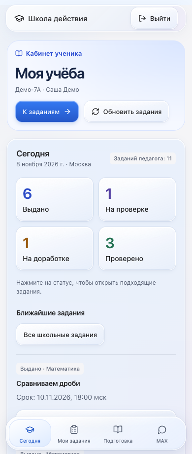
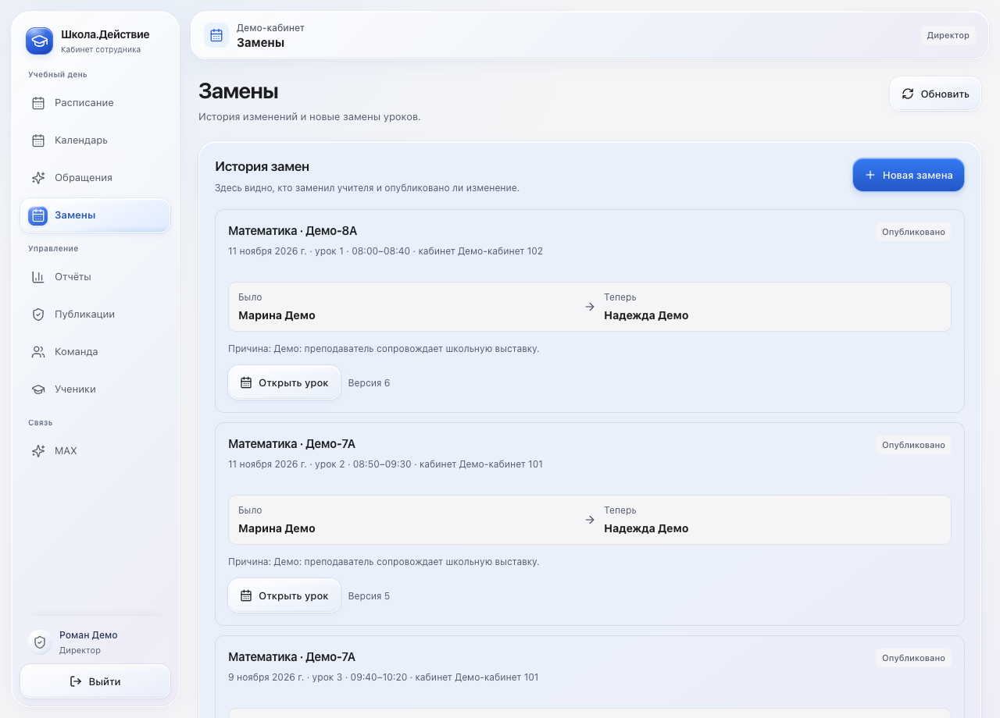
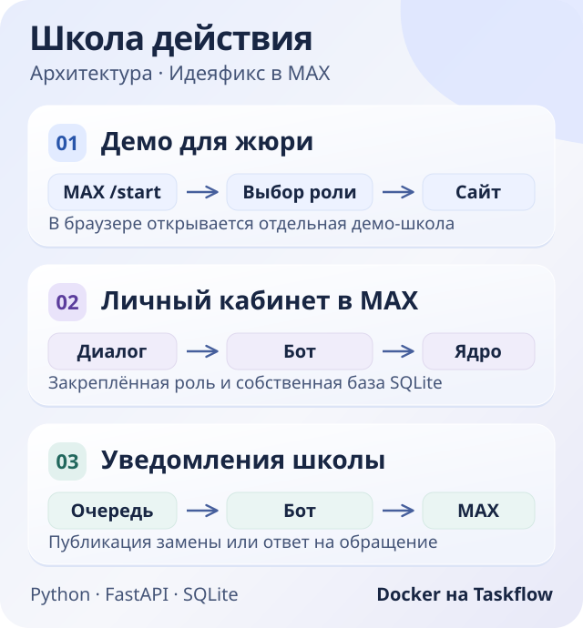

# Школа действия в MAX

Расписание, замены и задания в MAX. Четыре демо-роли открывают школьный кабинет в браузере. Личный кабинет в чате работает на отдельном ядре.

**[Открыть бота MAX](https://max.ru/ideya_fiks_150_bot)** · **[Демо-школа](https://taskfloww.site/school-staff/)** · **[Релиз с Docker-образом](https://github.com/ozerinpro-arch/ideyafix-max/releases/tag/hackathon-taskflow-2026-11-08-fix)**

## Попробовать за минуту

1. Откройте бота и нажмите **«Начать»** или отправьте `/start`.
2. Выберите ученика, преподавателя, завуча или директора.
3. Скопируйте логин и пароль и нажмите **«Перейти в школу»**. При смене роли выйдите из открытого веб-кабинета и войдите с новой парой.

| Роль | Что открыть в веб-школе |
| --- | --- |
| Ученик | Задания, отправленные работы и комментарии преподавателя |
| Преподаватель | Своё расписание, материалы урока, выдачу и проверку заданий |
| Завуч | Общую сетку, календарь, обращения и публикацию замен |
| Директор | Расписание, отчёты, публикации и списки школы |

Данные вымышленные. **«Мой кабинет MAX»** появляется у пользователя с личной привязкой. Сотрудники могут подключить адресные уведомления о заменах и ответах на обращения через раздел **MAX** в личном веб-кабинете.

## Как выглядит

| Расписание в MAX | Задания ученика на телефоне |
| --- | --- |
| <a href="docs/demo/schedule.jpg"></a> | <a href="docs/demo/school-student.png"></a> |

<details>
<summary>Вход в веб-школу, кабинет завуча и замены</summary>

[Вход с телефона](docs/demo/school-login.png) · [Кабинет завуча в MAX](docs/demo/home.jpg) · [Раздел «Замены» в MAX](docs/demo/replacements.jpg)



</details>

## Архитектура

[](docs/ARCHITECTURE.md)

Бот работает на Taskflow в Docker. Он получает события через исходящий Long Polling и обрабатывает личные действия во встроенном ядре Python, FastAPI и SQLite. Веб-школа развёрнута отдельно со своими демо-данными. [Компоненты, диаграмма доставки и границы доступа](docs/ARCHITECTURE.md).

## Скачать и запустить

Архив релиза содержит образ **Linux AMD64**, который работает на Taskflow, исходники соответствующей версии и контрольные суммы.

Скачайте [архив образа](https://github.com/ozerinpro-arch/ideyafix-max/releases/download/hackathon-taskflow-2026-11-08-fix/ideyafix-max-taskflow-linux-amd64.tar.gz) и `SHA256SUMS.txt` со [страницы релиза](https://github.com/ozerinpro-arch/ideyafix-max/releases/tag/hackathon-taskflow-2026-11-08-fix). Загрузите образ или соберите его из корня репозитория.

```sh
# Готовый образ из релиза
shasum -a 256 -c SHA256SUMS.txt --ignore-missing
docker load -i ideyafix-max-taskflow-linux-amd64.tar.gz

# Сборка из исходников
docker build -t ideyafix-max:local .
```

Подготовьте конфигурацию своего бота и запустите его по [инструкции Docker](docs/DOCKER.md#приватные-файлы-на-компьютере). Там есть Compose, `docker run` и проверка образа без сети.

Для запуска без Docker используйте Python 3.12:

```sh
python3.12 -m venv .venv
.venv/bin/python -m pip install -r requirements.txt
.venv/bin/python -B -m app.polling --config /absolute/private/connection.json
```

Для CLI в конфигурации нужны абсолютные пути компьютера. ИИ-генерация на стенде выключена. Материалы и задания можно готовить и проверять вручную. [Проверки](docs/TESTING.md) · [Безопасность](docs/SECURITY.md) · [Требования](docs/PRD.md).
