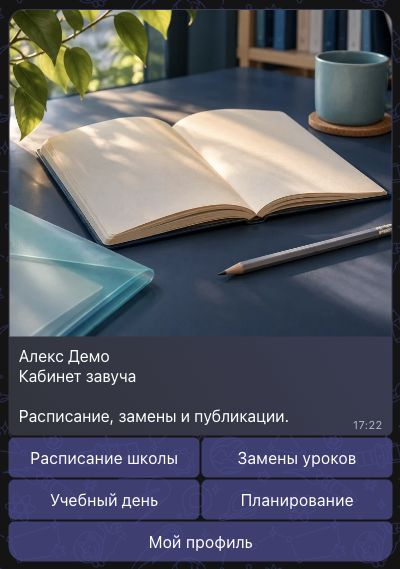
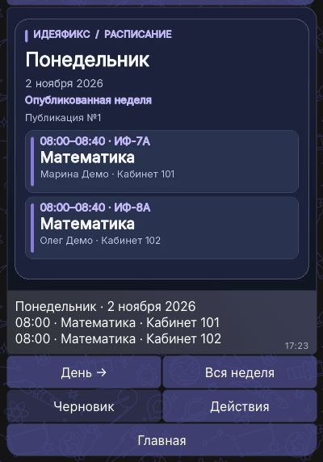
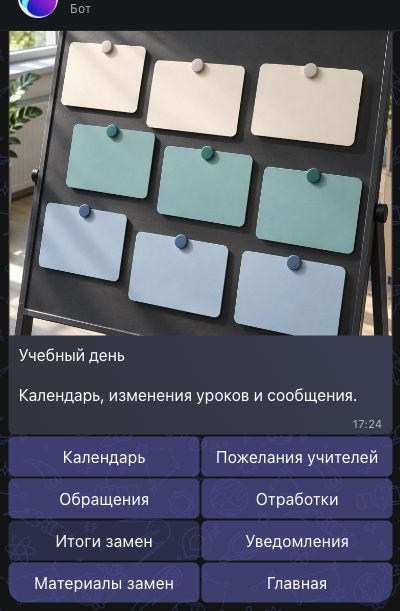

# Идеяфикс в MAX

Учебный кабинет в MAX для ученика, преподавателя, завуча и директора. Бот открывает разделы по роли и присылает расписание на день и неделю картинкой вместе с кнопками. Проект запускается на собственном ядре и вымышленных данных.

[Открыть бота MAX](https://max.ru/ideya_fiks_150_bot) · [GitHub](https://github.com/ozerinpro-arch/ideyafix-max) · [Релиз и Docker-образы](https://github.com/ozerinpro-arch/ideyafix-max/releases/tag/hackathon-max-visual-2026-11-07)

Кадры из настоящего MAX с тестовым профилем завуча:

| Кабинет | Опубликованное расписание | Учебный день |
|---|---|---|
|  |  |  |

## Возможности

- Расписание: личные карточки дня и недели, черновик и опубликованная неделя для завуча и директора, календарь, предпочтения, редактор и расчёт, согласование, обращения, замены и уведомления.
- Обучение: подготовка и версии материалов, передача при замене, личные задания, черновики, сдача, проверка, переписка и выгрузка полного текста. Журнал, консультации и аналитика.
- Кружки: программы, запись, вымышленные начисления, PDF-документы и сверка. Импорт/экспорт, доступы и восстановление версии расписания.

ИИ сейчас **выключен**. Для нового ключа NanoGPT не найден подходящий бесплатный доступ к API универсальной модели. Платные вызовы и автоматический платный fallback не включены. Ручная подготовка материалов и учебная работа доступны без ИИ. Локальная модель отменена пользователем.

## Личные кабинеты

Администратор выдаёт одноразовую личную ссылку. Получатель открывает её в MAX и нажимает «Начать». Простое открытие общей ссылки бота не предоставляет права администратора.

Девять начальных вымышленных профилей раздельны; Славик и Саша — разные ученики с разными заданиями. Приглашённый человек получает отдельный профиль с закреплёнными правами. Только тестовый оператор может переключать вымышленные роли; обычный пользователь через `/role` просматривает свой профиль.

`/start` и `/home` открывают кабинет, `/cancel` отменяет текущий ввод. Выберите раздел кнопкой и подтверждайте изменения после проверки. Например, завуч открывает «Учебный день» → «Материалы замен» → «Текущие передачи». Повторы событий не создают копии изменений, диалог сохраняется после перезапуска.

## Docker: сборка и запуск

Нужен работающий Docker. Бот получает события исходящим Long Polling: публичный сайт, порт и webhook не нужны. Компьютер и процесс бота должны оставаться включёнными.

```sh
docker build -t ideyafix-max:local .

mkdir -p runtime/container-private runtime/container-data
chmod 700 runtime/container-private runtime/container-data
cp config/max.example.json runtime/container-private/connection.json
cp app/assets/max_public_root.cert runtime/container-private/additional-ca.pem
chmod 600 runtime/container-private/connection.json runtime/container-private/additional-ca.pem
```

Создайте приватный файл `runtime/container-private/max-token.txt`, содержащий только токен вашего бота, и установите права `chmod 600` для него. В `connection.json` задайте `botUsername`, включите `enabled:true` и укажите актуальное `activatedAtMs` — время начала приёма в миллисекундах UTC. `platformEnabled:true` включает полную платформу. Пример по умолчанию выключен и не обращается к MAX. Пути примера уже соответствуют контейнеру.

```sh
docker run --rm --init --name ideyafix-max \
  --user "$(id -u):$(id -g)" --read-only \
  --cap-drop ALL --security-opt no-new-privileges \
  --tmpfs /tmp:rw,nosuid,nodev,mode=1777 \
  --tmpfs /private/tmp:rw,nosuid,nodev,mode=1777 \
  --mount "type=bind,src=$PWD/runtime/container-private,dst=/run/private,readonly" \
  --mount "type=bind,src=$PWD/runtime/container-data,dst=/app/runtime" \
  ideyafix-max:local --config /run/private/connection.json
```

Запускайте от обычного пользователя компьютера. Токен не передаётся через Dockerfile или переменные окружения. Дополнительный публичный CA применяется только к клиенту MAX, проверка TLS остаётся включённой. Настройки монтируются только для чтения, собственные данные сохраняются в `runtime/container-data`.

В [релизе](https://github.com/ozerinpro-arch/ideyafix-max/releases/tag/hackathon-max-visual-2026-11-07) доступны отдельные архивы для Linux x86-64 и ARM64. Вместо сборки загрузите нужный образ:

```sh
# Linux x86-64:
docker load -i ideyafix-max-linux-amd64.tar.gz
docker tag ideyafix-max:amd64 ideyafix-max:local
# Apple Silicon / Linux ARM64:
# docker load -i ideyafix-max-linux-arm64.tar.gz
# docker tag ideyafix-max:arm64 ideyafix-max:local
```

Первоначальное личное приглашение тестового оператора создаётся локальной командой до запуска приёмника. Команда, Docker Compose, проверка состояния и все настройки приведены в [инструкции Docker](docs/DOCKER.md). Одноразовую ссылку сохраняйте приватно.

## Запуск через CLI

Python 3.12. Все 78 зависимостей закреплены полными версиями в `requirements.txt` и `requirements.lock`.

```sh
python3.12 -m venv .venv
.venv/bin/python -m pip install -r requirements.txt
.venv/bin/python -B -m app.polling --config /absolute/private/connection.json
```

Для CLI замените контейнерные пути примера на абсолютные пути своего компьютера. Каталог приватных настроек должен иметь права 0700, файлы настройки, токена и дополнительного CA — 0600 и принадлежать запускающему пользователю. Не используйте одну базу одновременно в CLI и Docker.

Необязательная локальная консоль подключения запускается отдельно:

```sh
.venv/bin/python -B run.py --max-config /absolute/private/connection.json
```

Она доступна только на `http://127.0.0.1:5211/`; пользователю бота консоль не нужна. В полной версии предметные действия выполняются в MAX.

Для наполненного вымышленного учебного кабинета перед запуском приёмника можно выполнить:

```sh
.venv/bin/python -B -m app.demo_seed
```

Команда создаёт через собственные API один материал преподавателя и два отдельных задания — Славику и Саше. ИИ не вызывается; повтор не добавляет копии. Ядром владеет один процесс, поэтому приёмник на это время должен быть остановлен.

## Проверки и безопасность данных

```sh
.venv/bin/python -B -m unittest discover -s tests -v
# Проверка native-ядра в контейнере без сети:
docker run --rm --network none --entrypoint python ideyafix-max:local \
  -B -m unittest tests.test_platform_runtime -v
```

Автотесты используют временные вымышленные базы, настоящее собственное ядро и его проверки доступа; сеть MAX заменяется тестовым транспортом. Итоговая проверка на компьютере: **201/201 PASS**, 259,226 с. Образы ARM64 и AMD64 собраны, загружены и проверены отдельно. В репозитории и образах нет runtime-баз, токенов, реальных MAX ID или личных приглашений.

Карты функций: `app/platform_*_inventory.json`; итоговый план: [full-platform-plan.json](full-platform-plan.json). Документы: [требования](docs/PRD.md), [архитектура](docs/ARCHITECTURE.md), [безопасность](docs/SECURITY.md), [проверки и доказательства](docs/TESTING.md).
