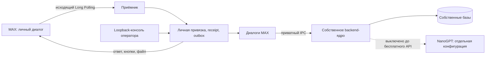

# Архитектура

Собственный Python 3.12 проект. Исходная веб-платформа служит источником backend-кода, но не участвует в runtime. platform_engine/fork-provenance.json фиксирует происхождение и изменения. Фронтенд и реальные данные не копировались.

Poller проверяет бота и отсутствие webhook. Native parser допускает только личные диалоги. Batch сохраняется до продвижения курсора. PlatformStore владеет привязками, приглашениями, непрозрачными кнопками и outbox. Кнопка привязана к отправителю, чату, профилю и TTL. Только прежний тестовый оператор переключает роли.

PlatformAssistant направляет события в ScheduleAssistant и LearningAssistant. Разговоры хранятся в conversations.sqlite3, маршрутизатор отдельно в router.sqlite3. Intent сохраняется в начале действия; повторное подтверждение после потери ответа использует тот же native event/payload.

PlatformRuntime запускает отдельный дочерний процесс с очищенным окружением и своим путём импорта. Copied ASGI API вызывается in-process без HTTP-listener. Каждый профиль получает настоящую native cookie/CSRF сессию. Owner использует штатную owner principal. Gateway сохраняет STARTED перед изменением, кэширует завершённый результат, не повторяет неопределённое изменение автоматически.

PDF использует исходные проверки документа и принадлежности с отдельным долговечным локальным журналом задач. Файлы передаются IPC и загружаются в MAX. Импорт вызывает настоящий parser/preview/apply ядра. Токен бота передаётся только фиксированному API MAX, никогда — CDN адресу загрузки. HTTPS/CDN адреса и размер файлов ограничены.

Для native приглашения отдельный журнал фиксирует владельца MAX кода до IPC; собственный native журнал связывает токен с единственным принятым профилем. Потеря внешней транзакции не позволяет отдать профиль другому отправителю.

Консоль 127.0.0.1:5211 предназначена оператору. В полном режиме веб-чат запрещён; предметные действия выполняются в MAX. Прежнее маленькое demo-ядро обслуживает сценарий самого хакатона и режим совместимости, не подменяет учебное ядро. На текущем запуске ИИ выключен: валидный ключ сам по себе не даёт бесплатной модели или квоты, платный fallback отсутствует.

Перед выдачей сохранённой страницы, файла и перед отправкой из outbox повторно проверяются текущие native права. Архив личной записи ученика закрывает и старый кэш. PDF и переданный материал дополнительно проверяют текущий документ/версию/grant; generic GET страницы сверяют свежий fingerprint. Полученный MAX batch сначала сохраняется в приватный spool; восстановление обрабатывает его до нового запроса к API, курсор и удаление batch фиксируются атомарно.
