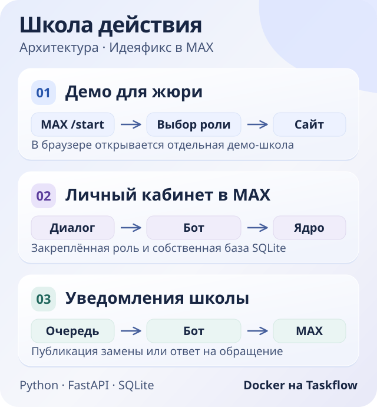
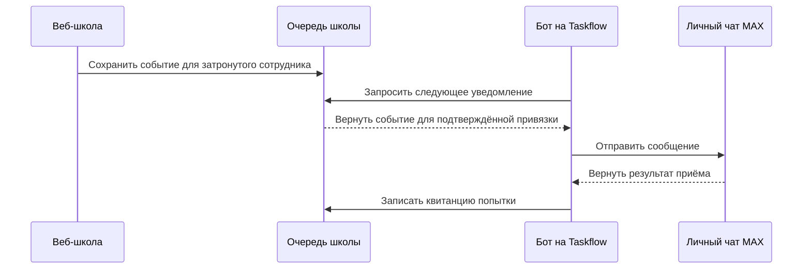

# Архитектура «Школы действия»

[Открыть бота MAX](https://max.ru/ideya_fiks_150_bot) · [Открыть веб-школу](https://taskfloww.site/school-staff/) · [Запуск в Docker](DOCKER.md)

## Три маршрута

| Маршрут | Как проходит действие | Где хранятся данные |
| --- | --- | --- |
| Демо для жюри | `/start` → роль → данные для входа → кнопка «Перейти в школу». Браузер открывает отдельное HTTPS-приложение. | Изолированная база веб-школы с вымышленными данными. |
| Личный кабинет MAX | Личная одноразовая ссылка связывает профиль с чатом. `/home` и кнопки открывают разделы по закреплённой роли. | Собственная SQLite бота и независимого ядра. |
| Уведомления школы | В личном веб-кабинете сотрудник подтверждает связь с MAX. При публикации замены или адресном ответе бот забирает уведомление из очереди. | Веб-школа хранит согласие, очередь и статус отправки. Бот хранит квитанции попыток. |

Подключение уведомлений связывает только учётную запись веб-школы и подтверждённый чат. Школьные записи и сессии двух приложений ведутся раздельно.

## Компоненты бота

| Компонент | За что отвечает |
| --- | --- |
| [Приёмник MAX](../app/polling.py) | Запрашивает обновления исходящим Long Polling, проверяет бота, сохраняет пакет до продвижения курсора, отправляет ответ. |
| [Хранилище диалога](../app/platform_store.py) | Связывает чат с профилем, проверяет кнопки, хранит состояние и очередь ответов. Публичное меню формирует [модуль демо-ролей](../app/school_demo_links.py). |
| [Диспетчер](../app/platform_assistant.py) | Направляет команды в сценарии расписания, обучения и управления, проверяет права на данные и файлы. |
| [Независимое ядро](../platform_engine/) | Выполняет школьные операции в отдельном процессе. [Шлюз](../app/platform_runtime.py) вызывает FastAPI внутри процесса ядра по приватному IPC. |
| [Клиент уведомлений](../app/school_notification_client.py) | Забирает очередь через отдельный HTTPS-канал и сообщает результат отправки веб-школе. |

## От публикации замены до MAX

Тот же маршрут используется для адресного ответа на обращение. Квитанция означает результат приёма сообщения API MAX. Для попытки с неопределённым результатом автоматическая повторная отправка отключена.

## Права, надёжность и размещение

- MAX принимает команды в личном чате. Кнопки, меняющие состояние, привязаны к отправителю, чату, профилю и сроку действия. Старые кнопки выбора демо-роли работают в том же чате. Служебная сессия личного кабинета обновляется после истечения, а права проверяются заново.
- SQLite сохраняет курсор Long Polling, входящий пакет, состояние диалога и квитанции. Повтор уже обработанного события не запускает действие повторно. Доступ к личным данным, документам и материалам перепроверяется перед выдачей.
- На Taskflow работают отдельный Docker-контейнер бота и веб-школа. Контейнер монтирует настройки только для чтения и хранит состояние на отдельном томе. Входящий порт и webhook для бота не нужны.
- Исходный код ядра и его происхождение описаны в [fork-provenance.json](../platform_engine/fork-provenance.json). Ограничения размещения и конфигурация приведены в [инструкции Docker](DOCKER.md) и [документе по безопасности](SECURITY.md).
